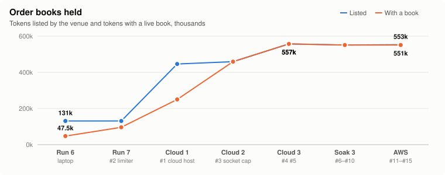
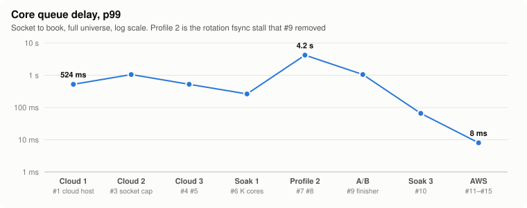
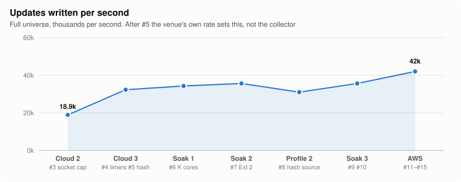
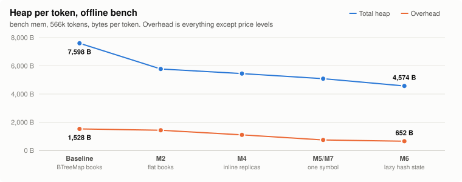
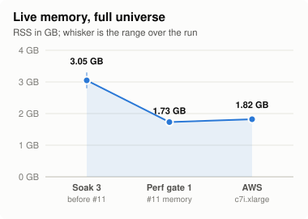
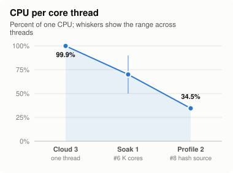
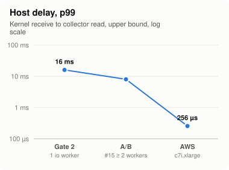
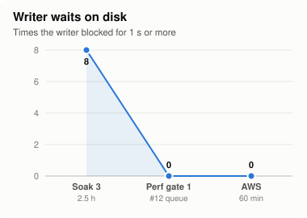

# Polymarket order-book collector

A Rust collector that subscribes to every live Polymarket market, keeps an L2 book per outcome
token, and writes deltas plus a full snapshot of every book each minute to an aligned FIX SBE file
(the challenge template's format and helpers).

Polymarket is the venue it runs against: Kalshi could not be reached from where this was built
(India), and the challenge allows that fallback. A Kalshi adapter exists too (`--venue kalshi`).
It runs on the same engine and passes end-to-end tests against a mock of Kalshi's documented API,
but it has never run live, which needs a Kalshi API key. See [docs/KALSHI.md](docs/KALSHI.md).

## Start here

```bash
./demo.sh
```

That builds, replays the committed two-minute capture from the AWS run (`sample/`, offline),
runs every test against mock venues on localhost, then runs 2,000 live markets for two minutes
and replays that file too. Each step stops on a failure. `./demo.sh sample`, `./demo.sh test`
and `./demo.sh live [SECS] [MARKETS]` run one step.

Without a Rust toolchain, the same binaries are in a Docker image:

```bash
docker build -t collector .
```

```bash
docker run --rm -v "$PWD/out:/out" collector --out /out/ob.sbe --max-markets 2000 --duration-secs 120
```

```bash
docker run --rm -v "$PWD/out:/out" --entrypoint verify collector /out/ob.sbe
```

**Grading:** [docs/GRADING.md](docs/GRADING.md) has the five-minute path, a table from each claim
to the command that reproduces it, and what every counter means. The measured numbers are in
[docs/PERFORMANCE.md](docs/PERFORMANCE.md).

| Doc | What it covers |
|---|---|
| [docs/ARCHITECTURE.md](docs/ARCHITECTURE.md) | Components, data flow, and how each extension is met |
| [docs/DECISIONS.md](docs/DECISIONS.md) | The choices made, with the alternative and why it lost |
| [docs/LATENCY.md](docs/LATENCY.md) | Ext 4: what is measured, what is built, what is still untested |
| [docs/KALSHI.md](docs/KALSHI.md) | Ext 3: the Kalshi adapter, what the trait had to change, what a live run must check |
| [docs/GRADING.md](docs/GRADING.md) | Five-minute check, claim → evidence table, flags, counters, clock-corrected latency |
| [docs/PERFORMANCE.md](docs/PERFORMANCE.md) | The full universe on a c7i.xlarge: latency, CPU, memory, a three-region probe, benchmarks |
| [docs/DEPLOY.md](docs/DEPLOY.md) | Host requirements, AWS / GCP / Hetzner equivalents, systemd unit, shipping output |
| [docs/AWS-RUN.md](docs/AWS-RUN.md) | The one-shot AWS run that produced PERFORMANCE.md: hosts, phases, safety, how to rerun it |
| [docs/ENGINEERING-LOG.md](docs/ENGINEERING-LOG.md) | Every run, bug and fix, in order; charted under "How each fix moved the numbers" below |

## Requirements checklist

| Requirement | Where it is met | Evidence |
|---|---|---|
| Every live market, new listings in, resolved ones out | Gamma keyset discovery every 10 min, `new_market` / `market_resolved` events, universe cache (D16) | 280k markets, 548k–554k tokens sourced of 549k–556k listed on AWS; e2e `resolved_close` |
| Many websockets, tokens balanced across them | Shards of `--tokens-per-conn`, × `--replicas` (`core/plan.rs`) | 442–452 sockets on the full universe |
| One L2 book per token | `book.rs`, owned by core threads | hash check on every delta (98.9–100%) |
| `PriceLevelUpdate` per level change, `Snapshot` per symbol every 60 s | `core/emit.rs` → `writer.rs`, template `AlignedSbeWriter`, 64 MiB chunks | `verify`: 0 replay mismatches in every run |
| Snapshot on a source switch | `core/emit.rs` `adopt`: diff, then snapshot (D8) | e2e `dropped_socket`: `switch_snaps` ≥ 1 |
| SIGINT: close sockets, flush, close the file | `main.rs` shutdown order, on SIGINT and SIGTERM; also on a panic (D20) | every run ends with `done` and a readable file; e2e `sigterm_flushes` |
| Output to stdout by default | `--out` defaults to `-`; a path writes a file (D4) | `collector --max-markets 50 > ob.sbe` then `verify ob.sbe`: OK; it refuses to write binary to a terminal |
| No multivariate events (Kalshi) | `mve_filter=exclude` on discovery and lookup (`adapter/kalshi.rs`); Polymarket has none | [docs/KALSHI.md](docs/KALSHI.md) |
| Ext 1: redundancy | 2 replicas per shard on different edges, source arbitration, lag check, `--supervise` | e2e drop / silent / stall / delay / supervise; 224-socket edge kill live |
| Ext 2: silent failures and exchange-side decay | venue hash ladder, quiet resubscribe, per-socket quiet reconnect, make-before-break recycling | e2e corrupt / stall; hourly recycle of 448 sockets with no gaps |
| Ext 3: a second exchange | `ExchangeAdapter` trait; Polymarket and Kalshi adapters (`src/adapter/`), `--venue` | Kalshi e2e: seq gap → failover, listing → subscribe; never run live ([docs/KALSHI.md](docs/KALSHI.md)) |
| Ext 4: latency | per-socket latency (`--lat-detail`), `--fast-source`, a TCP source-port experiment (`--src-ports`), clock offset (D21) | [docs/LATENCY.md](docs/LATENCY.md) |

## Build and run

Needs a stable Rust toolchain (edition 2024).

```bash
cargo build --release --bins
```

The SBE stream goes to stdout and logs go to stderr:

```bash
./target/release/collector > orderbook.sbe
```

Or to a file:

```bash
./target/release/collector --out orderbook.sbe
```

It refuses to write binary to a terminal. Stop with Ctrl-C: the first SIGINT closes every
websocket, writes the last chunk and closes the output. A second SIGINT forces an exit. SIGTERM
(`kill`, `docker stop`, systemd) does the same.

To restart it automatically if it dies:

```bash
./target/release/collector --supervise > orderbook.sbe
```

A small run for trying it out:

```bash
./target/release/collector --out small.sbe --max-markets 2000 --duration-secs 120
```

### Flags

| Flag | Default | Meaning |
|---|---|---|
| `--venue` | `polymarket` | `polymarket` or `kalshi`. Kalshi needs `KALSHI_API_KEY_ID` and `KALSHI_PRIVATE_KEY_PATH` (docs/KALSHI.md). |
| `--out` | `-` | `-` is stdout, anything else a file path. Truncated on start. |
| `--supervise` | off | Run as a child process and restart it when it dies (D20). |
| `--rotate-mins` | `0` | Cut output into files of this many minutes, named by period start. Each file replays on its own. |
| `--tokens-per-conn` | `2500` | Tokens per websocket (one shard). |
| `--replicas` | `2` | Independent sockets per shard, pinned to different edge IPs when DNS returns more than one. |
| `--max-conns` | `600` | Cap on steady-state sockets (shards × replicas). |
| `--lag-ms` | `3000` | Switch a shard's source when a peer has seen an event the source has not for this long (D10). |
| `--core-threads` | `0` | Threads that own book state. 0 = half the CPUs, at most 8. |
| `--core-queue` | `65536` | Decoded frames queued per core before socket readers wait. |
| `--io-threads` | `0` | Tokio workers for sockets, TLS and decoding. 0 = CPUs − core threads − 1, at least 2. |
| `--writer-queue-mb` | `256` | Output queued in memory before the cores wait for the writer. Nothing is dropped; the status line logs `queue_hwm_mb` and `queue_waits`. |
| `--pin` | off | Linux: each core thread on a CPU of its own, every other thread on the rest. |
| `--kernel-ts` | off | Linux: `recv_ts` is the kernel receive time (`SO_TIMESTAMPNS`); logs `host delay` (app − kernel) every 30 s. |
| `--recycle-mins` | `60` | Make-before-break reconnect of every socket older than this (0 = never). |
| `--split-ratio` | `0` | Split a shard once its rate passes this multiple of the median (0 = never; see DECISIONS). |
| `--rediscover-mins` | `10` | Re-run full discovery this often. |
| `--universe-cache` | `universe.json` (`universe-kalshi.json` for Kalshi) | Instrument list from the last run, used to subscribe before discovery finishes. |
| `--max-markets` | `0` | Only collect this many markets (0 = all). |
| `--opens-per-sec` | `10` | Websocket handshakes per second across all sockets. |
| `--duration-secs` | `0` | Stop after this long (0 = run until SIGINT). |
| `--lat-detail` | off | Log per-socket and per-edge latency every 30 s (Ext 4, see LATENCY). |
| `--fast-source` | off | Prefer each shard's fastest socket as source and recycle one that stays slowest (see LATENCY, Experiment 2). |
| `--fast-margin-ms` | `3` | With `--fast-source`: how much slower the preferred socket must be before it changes. |
| `--fast-weight` | `0.25` | With `--fast-source`: weight of the newest 30 s window in a socket's score. |
| `--fast-stall-ms` | `4` | With `--fast-source`: a 30 s window in which even a shard's best socket averaged this far behind is a venue stall and is not scored (0 = score every window). |
| `--edge-ip`, `--src-ports` | off | Experiment 3: pin every socket to one edge IP; bind replica r to the r-th local port (0 = ephemeral). |
| `--ntp-server` | `time.google.com:123` | Measure and log the host clock offset at start and every 10 min (D21). Empty = off. |

## Output

Each outcome token is written as two symbols, `<token_id>:bid` and `<token_id>:ask`, because the
schema's `PriceLevelUpdate` has no side field. The template's `Snapshot` has both a bids and an
asks list, but each of our snapshots fills only the side its symbol names.

- **Prices and sizes** are fixed point, `i64` with 1,000,000 = 1.0.
- **`PriceLevelUpdate`** carries the absolute size at a price. Size 0 removes the level.
- **`Snapshot`** is written for both sides of every book once a minute, spread over the minute,
  and whenever a book first appears.
- **Timestamps:** `recv_ts` is our receive time. `exch_ts` is the exchange's timestamp of the last
  event applied to that book.
- **A market that closes** gets a size-0 update for each of its remaining levels, so readers'
  books end empty.
- **Invariant:** each side's last snapshot plus the updates since it equals the next snapshot,
  exactly. That holds across source switches (see ARCHITECTURE).
- **Chunks** are 64 MiB, the size the template reader is fixed at.

## Verify a file

```bash
./target/release/verify orderbook.sbe
```

`verify` replays every side from its snapshots and updates and checks that each rebuild matches
the next snapshot exactly. It also flags:
- bad prices or sizes;
- an update before its symbol's first snapshot;
- unordered or two-sided snapshots;
- malformed symbols;
- crossed books.

It exits non-zero on any failure. Every output file from every run in the log passed with 0
mismatches.

## Tests

```bash
cargo test --release
```

- Unit tests cover the core (failover, integrity, Ext 2, recycling, rotation, removal), the
  connection actor, the writer and fixed-point parsing.
- Three golden tests in `tests/golden.rs` replay captured live Polymarket frames from
  `tests/fixtures/` through decode and the hash check. They pin the verdict counts, including
  the 98.9% pass rate on the trade-heavy capture.
- Ten end-to-end tests in `tests/e2e.rs` run the real binary against a mock venue on
  localhost (Gamma over HTTP, the market websocket with correct hashes). Each injects one
  fault and checks the reaction in the final metrics, then runs `verify` on the output:
  dropped socket, silent socket, one stalled subscription, a 5 s delay, a corrupt update,
  Gamma 429s, a resolved-assets close, a panic under `--supervise`, and a stop by SIGTERM.
  About 45 s.
- Three end-to-end tests in `tests/kalshi_e2e.rs` run the same binary with `--venue kalshi`
  against a mock Kalshi (signed handshake, `sid` acks, relative deltas with `seq`):
  a baseline, a `seq` gap that must fail over and reconnect, and a lifecycle listing that must
  join the existing subscription.
- CI (`.github/workflows/ci.yml`) runs clippy with `-D warnings` and all of the above, replays
  the sample capture, and builds the Docker image and runs `verify` on the sample inside it.

## Results

All runs were against live Polymarket. The headline run is one hour of the full universe on an
AWS c7i.xlarge (4 vCPU, 8 GB) in London, build 7170677. Details, the method and how to rerun it
are in [docs/PERFORMANCE.md](docs/PERFORMANCE.md).

| | c7i.xlarge, eu-west-2, 60 min |
|---|---|
| Coverage | 280,559 markets; 548k–554k tokens sourced on 442–452 sockets |
| Throughput | 41–43k updates/s; 9 MB/s to disk |
| Correctness | 8 files, about 33 GB, about 55M snapshots replayed: **0 mismatches** |
| Host delay (kernel receive → collector) | p50 ≤ 32 µs in every 30 s window; p99 ≤ 128–256 µs in most |
| recv − exch | p50 8–9 ms, p99 50–348 ms (London; Ireland p99 73 ms, Virginia p50 43 ms) |
| CPU | load 1.2 of 4 vCPU: core threads 47%, tokio 54%, writer 6% of one CPU |
| Memory | RSS 1.8 GB mean, 1.9 GB peak, flat |
| Crash | `kill -9` of the child: back in 1 s under `--supervise`, open file recovered |

Earlier, a GitHub Codespace (4 vCPU, 16 GB, West Europe) ran the long soak on build 1a4d84c:

- **2.5 hours:** 320M updates and 184M snapshots in 16 files of 10 minutes each, 0 replay
  mismatches, 0 restarts, and 535 venue disconnects, all healed by reconnect and failover.
- **Faults injected live:** killing all 224 sockets to one edge moved those tokens to their
  replicas with no replay error; a 15 s process freeze recovered; the hourly recycle of all 448
  sockets left no gaps.
- **Host limits:** the Codespace disk (about 8.5 MB/s) stalled the writer eight times for
  1.0–1.5 s, and its clock drifted by up to 88 ms. Neither happened on AWS.

The full table of runs is at the top of [docs/ENGINEERING-LOG.md](docs/ENGINEERING-LOG.md).

## How each fix moved the numbers

Each point is a run against live Polymarket; the grey line under each run names the fixes (#n,
from the bottleneck table in [docs/ENGINEERING-LOG.md](docs/ENGINEERING-LOG.md)) that landed
before it. Hosts and builds change along the x axis: Runs 6–7 are a laptop on a VPN, Cloud and
Soak runs a GitHub Codespace, AWS the c7i.xlarge. The values come from
[docs/charts/data.json](docs/charts/data.json); `python3 docs/charts/make_charts.py` redraws them.









<p>


</p>
<p>


</p>

The same data as a table:

| # | Fix | Metric | Before | After |
|---|---|---|---|---|
| 1 | Cloud host near London | exch→recv p99 | minutes | 173 ms |
| 2 | Open limiter, book re-ask | tokens with a book | 47.5k | 96k (link-bound) |
| 3 | Socket cap from the universe, 429 backoff | tokens placed | 250k | 459k (all) |
| 4 | Timers before inbound | exch→recv p99 | 71 s | 524 ms |
| 5 | Hash once per check | updates/s | 18.9k | 32.3k |
| 6 | K core threads | CPU of the busiest core thread | 99.9% | 50–90% |
| 7 | Rate-aware quiet detection | resubscribes in 90 min | 400k | the truly quiet tokens only |
| 8 | Hash only the source | core thread CPU | 50–60% | 31–38% |
| 9 | fsync off the writer | time blocked in rotation | 330 s and 1,153 s | 0 in 11 rotations |
| 10 | Drop resolved tokens | disconnects in the A/B | ×11–19 | loop gone |
| 11 | Memory layout | live RSS | 3.0 GB | 1.73 GB |
| 12 | Byte-bounded writer queue | writer waits on disk | 8 | 0 |
| 13 | `--kernel-ts` | what host delay measures | TLS + parse + scheduling | kernel → read, p50 ≤ 128 µs |
| 14 | Count CPUs before pinning | core threads with `--pin` | 1 | 2 |
| 15 | At least 2 io workers | host delay p99 | 8–16 ms | 4–8 ms |
| 16 | Write chunks in place as they fill | data kept by a `kill -9` at 120 s | 0 (empty file) | 119.8 s, 0 mismatches |

## Known limits

- **A `kill -9` loses what was still queued.** Messages are written into the open 64 MiB file
  chunk in place as soon as the writer's queue empties (D11), so a kill loses at most about
  1 MiB, not the chunk. Stdout still writes whole chunks, so a kill there loses the chunk being
  filled. A panic loses nothing. Under `--supervise` the collector is back within seconds; the
  gap is marked in the output (D20).
- **Failover waits for evidence.** A silent subscription is detected when a peer replica has
  seen an event the source has not for `--lag-ms` (3 s by default). Until then readers have the
  source's stale book.
- **Latency is tuned to the venue's floor, not below it.** Four experiments (LATENCY.md). On
  AWS London (Experiment 4), `--fast-source` took 0.3 ms off the mean for 4.8× the switching,
  4 replicas gave nothing over 2, and kernel busy polling was a null result, so the defaults
  stand. A 1 s failover window (`--lag-ms 1000`) raised no false switches on 2,000 markets but
  is untried on the full universe. recv − exch p50 was 5 ms in every arm: the rest is the venue
  and the network path.
- **Kalshi is untested live.** The adapter passes against a mock built from Kalshi's docs.
  KALSHI.md lists what the first live run must check (per-subscription market limit, `seq`
  scope, lifecycle event names).
- **Core CPU.** The two core threads together use about 47% of one CPU on the full universe.
  The integrity hash is the largest part of core time (PERFORMANCE.md).
- **Some networks block the venue.** An ISP that answers `ws-subscriptions-clob.polymarket.com`
  with its own block page gives a live run with no data; `./demo.sh live` says so instead of
  passing. The sample and the tests need no network.

## Layout

| Path | What it is |
|---|---|
| `src/main.rs` | CLI, venue choice, discovery and lookup tasks, routing to core threads, shutdown |
| `src/core/` | Book state and source arbitration (`mod.rs`); shard planning (`plan.rs`); socket lifecycle and recycling (`conns.rs`); output, rotation and switches (`emit.rs`); integrity ladder and Ext 2 (`health.rs`); speed-aware source (`speed.rs`); counters (`metrics.rs`) |
| `src/conn.rs` | Websocket actor: connect, edge pinning, watchdog, reconnect, open limiter |
| `src/supervise.rs`, `src/clock.rs` | `--supervise` restart and `.part` recovery; NTP clock offset |
| `src/adapter/` | `ExchangeAdapter` trait, shared REST retry, the Polymarket and Kalshi adapters |
| `src/writer.rs` | Writer thread, rotation, background fsync |
| `src/book.rs`, `src/fixed.rs` | Book type, fixed-point parsing |
| `src/bin/verify.rs` | Output checker |
| `src/util/` | The template's SBE helpers, unchanged |
| `bench/` | Scripts and raw logs from the profiled, A/B, latency and AWS runs |
| `sample/` | Two minutes of live output from the AWS run, gzipped, with its log |
| `docs/charts/` | The README charts: `data.json` (values from the log) and `make_charts.py` (draws the SVGs) |
| `demo.sh`, `Dockerfile` | The reviewer's path in one script; the binaries in a slim image |

The template's original notes on the SBE schema are in
[challenge_orderbook.yaml](sbe_schemas/engineering_challenge/challenge_orderbook.yaml) and
`src/util/`.
