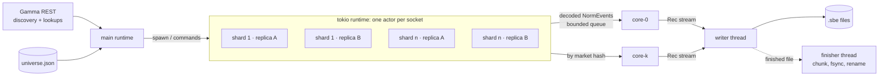

# Architecture

How the collector is put together, and where each part of the challenge is met. The reasons
behind the choices are in [DECISIONS.md](DECISIONS.md). The measured runs are in
[ENGINEERING-LOG.md](appendix/ENGINEERING-LOG.md).

## Shape



| Piece | Thread | Owns |
|---|---|---|
| **main** (`main.rs`) | tokio | Discovery, lookups of new markets, routing to cores, the 1 s tick, shutdown |
| **socket actor** (`conn.rs`) | tokio task each | One websocket: connect, subscribe, ping, watchdog, reconnect, decode |
| **adapter** (`adapter/`) | called by the actor and main | Everything venue-specific: URLs, frames, decode, discovery, integrity |
| **core** (`core/`) | 1–8 OS threads | All book state for its markets, the choice of source, all output records |
| **writer** (`writer.rs`) | 1 OS thread | The output files, and nothing else |
| **finisher** (`writer.rs`) | 1 OS thread | Closing finished rotated files |

Each core is a single-threaded state machine. It never touches the network or disk itself. It
asks for side effects (open a socket, send a command, look up a market) through an `Effects`
trait. That keeps it deterministic, and the 46 core unit tests drive it directly.

`src/core/` is split by concern: the data model, intake and tick loop in `mod.rs`, then
`plan.rs` (shards), `conns.rs` (socket lifecycle, recycling), `emit.rs` (output, rotation,
switches), `health.rs` (integrity ladder, quiet and lag checks), `speed.rs` (Ext 4) and
`metrics.rs`. Each is an `impl Core` block over the same state.

## Sharding and replicas

- **Discovery.** Gamma's market list is read by keyset paging. Each market has two outcome
  tokens.
  - On start, the cached universe from the last run is subscribed first, so books flow within
    seconds.
  - Gamma then reconciles: new markets are added and closed ones removed.
  - Discovery reruns every 10 minutes. The venue's `new_market` events trigger lookups in between.
- **Shards.** Tokens are packed into shards of `--tokens-per-conn` (2,500).
- **Replicas.** Each shard is subscribed on `--replicas` (2) independent sockets.
  - The websocket host's DNS answers are resolved once, and replicas are pinned to different edge
    IPs, so one bad edge cannot take both copies of a shard.
- **Scale.** At the full universe that is about 566k tokens on about 450 sockets.
- **Cores.** Markets are routed to a core by hash of the market id. A core owns both tokens of a
  market and every replica's view of them.
- **Open limiter.** Handshakes are spaced at `--opens-per-sec` (10/s) across all sockets. The
  venue times out handshakes that arrive in bursts. After 8 failed opens in a row anywhere, the gap
  grows towards 30 s. That stops hundreds of sockets retrying on their own from turning an outage
  into a storm.

## The book model: replicas and one emitted book

Per token the core keeps:

- **one book per replica**, built only from that socket's events;
- **the emitted book**: what a reader of the output file holds right now;
- **the source**: the replica whose events are written.

Only the source's events become `PriceLevelUpdate` records. The emitted book is updated as they
are written.

**Switching source** writes the diff between the emitted book and the new source's book, as
ordinary updates, copies the new book into the emitted one, and then writes a snapshot of both
sides, as the challenge asks. A reader never sees a jump: its last snapshot plus every update
since still equals the next snapshot, exactly, and `verify` checks this on every file. Why the
diff comes first is in DECISIONS (D8).

**No valid replica:** the token goes dark. Nothing is written for it until a fresh book arrives,
and then the diff from the emitted book and a snapshot are written. Deltas are never written against a book we
do not trust.

**Snapshots** of both sides of every published book are written once a minute. The tokens are
spread over 60 buckets, one bucket per tick, so the snapshot load is flat rather than one burst.
A snapshot is also written the first time a book appears.

## Ext 1: redundancy and failure handling

| Failure | How it is detected | What happens |
|---|---|---|
| **Socket closes or errors** | the actor's read fails | Down: tokens on it move to the best valid peer. The actor reconnects with backoff (250 ms to 30 s) and resubscribes. |
| **Silent disconnect** (TCP alive, no frames) | watchdog: no frame, not even a PONG, for 30 s (90 s before the first frame, since the initial dump can take 45 s) | same as a close |
| **Stalled subscription** (socket alive, one token silent) | lag check: a peer replica has a delta the source has not seen, and has had it for 3 s (timed from the oldest such delta) | the source is marked invalid, the token switches to the peer, the stale replica gets a resnapshot |
| **Corrupt or missed update** | the venue's `price_change` hash (SHA1 of the book) disagrees with the source's book | strike ladder below |
| **Rate limiting** | handshake timeouts and 429s | open limiter, circuit breaker, lookup batching (50 per call) |
| **Buffering / slow consumer** | the core queue is full | the reader waits (backpressure) instead of dropping. Per-socket blocked time is logged every 30 s. |
| **Venue closes a socket as "all assets resolved"** | the adapter matches the close reason | the reader drops those tokens without reconnecting. The core ends those markets with zero-size updates. |
| **Panic in any thread or task** | panic hook | the whole process shuts down in order (sockets closed, last chunk written) and exits non-zero, rather than run on with a dead core's markets silent (D20) |
| **Process crash or kill** | `--supervise`: the parent sees the child exit | restart with backoff (1 s doubling to 30 s). A file keeps every message written before the kill (D11); a torn stdout chunk is dropped, a reset marker separates the runs, crashed `.part` files are cut to whole chunks (D20) |

**Integrity ladder.** Polymarket's hash check passes 98.9–100% of the time on correct books (the
trade-heavy golden capture is 98.9%), so one miss alone is weak evidence. A miss on the source:

1. If a peer at the same event position holds a different book, the miss is corroborated. Refresh
   at once.
2. If a peer agrees with our book, the miss is counted as a probable false miss.
3. A second miss in a row refreshes either way.

A refresh moves the source off the replica first, then asks the venue for a fresh book for it,
so the resnapshot gap never reaches the output. Only the source is hashed; a standby is compared
book-to-book and starts being hashed the moment it becomes source.

## Ext 2: monitoring

- **Per-token activity.** Each token keeps a smoothed delta rate per minute. A token that no
  replica has heard from for `factor` (20) times its usual gap is resubscribed on every replica.
  - The wait is clamped between 60 s and 30 min.
  - Strikes double the wait.
  - At most 25 tokens are resubscribed per round.
  - Tokens slower than one delta a minute are left to recycling.
- **Per-socket activity.** A socket that saw no events in a 30 s window, while its peer saw at
  least 30, is reconnected.
- **Recycling.** Every socket older than `--recycle-mins` (60) is replaced make-before-break.
  - The new socket subscribes first.
  - The old one keeps serving until every book has arrived on the new one, or 60 s pass.
  - At most two shards recycle at a time, and only one replica of a shard, so its other replica
    stays put.
- **Metrics.** A status line every 30 s covers:
  - counts of switches, hash outcomes, resnapshots, quiet resubscribes and recycles;
  - exchange-to-receive (`wire`) and core queue latency histograms;
  - per-socket bytes, frames, decode time and blocked time, with the five busiest sockets.
  - with `--lat-detail`, per-socket and per-edge latency: `wire`, and how far each socket is
    behind the first to deliver the same event (see LATENCY).
- **Speed-aware source** (`--fast-source`, opt-in). Every 30 s the core scores each socket by
  its recent `behind`, prefers the fastest per shard, moves tokens onto it when its book equals
  the source's, and recycles a socket that stays slowest for 5 minutes (DECISIONS D19).

## Ext 3: the adapter boundary

Everything venue-specific is behind `ExchangeAdapter` (`src/adapter/mod.rs`):

```rust
pub trait ExchangeAdapter: Send + Sync + 'static {
    type Meta: Clone + Send + Sync + Serialize + DeserializeOwned + 'static;
    type Session: Default + Send; // per-socket venue state, owned by the socket actor
    const NAME: &'static str;
    fn ws_url(&self) -> &str;
    fn ws_request(&self) -> anyhow::Result<Request> { /* plain GET of ws_url() */ }
    fn ping_interval(&self) -> Duration;
    fn ping_frame(&self) -> Option<&'static str>; // None = websocket Ping frames
    fn subscribe_initial(&self, s: &mut Self::Session, tokens: &[Sym]) -> Vec<String>;
    fn subscribe(&self, s: &mut Self::Session, tokens: &[Sym]) -> Vec<String>;
    fn unsubscribe(&self, s: &mut Self::Session, tokens: &[Sym]) -> Vec<String>;
    fn resnapshot(&self, s: &mut Self::Session, tokens: &[Sym]) -> Vec<String> { /* unsub + sub */ }
    fn all_resolved(&self, _close_reason: &str) -> bool { false }
    fn decode(&self, s: &mut Self::Session, frame: &str, out: &mut Vec<NormEvent>) -> anyhow::Result<()>;
    fn discover(&self, pages: mpsc::Sender<Vec<Instrument<Self::Meta>>>) -> impl Future<Output = anyhow::Result<()>> + Send;
    fn lookup(&self, markets: &[Sym]) -> impl Future<Output = anyhow::Result<Vec<Instrument<Self::Meta>>>> + Send;
    fn integrity(&self) -> Box<dyn Integrity<Self::Meta>>;
}
```

- `decode` turns a frame into venue-neutral `NormEvent`s: `Book`, `Levels`, `Trade`, `TickSize`,
  `Listed`, `Resolved`.
- `Integrity` is the venue's own consistency check, which feeds the ladder above.
- The core, the socket actor, the writer and `verify` know nothing about Polymarket.

- A `decode` error of type `Resync` (a sequence gap, say) makes the socket actor drop the
  socket. The core then fails its tokens over and reconnects, the same path as a lost socket.

Two adapters implement it: `polymarket.rs` and `kalshi.rs`. `main.rs` is generic over the
trait, and `--venue` picks one. Kalshi needed a signed handshake, per-socket state (relative
deltas, `seq`, subscription ids) and a different re-snapshot. Those are the `ws_request`,
`Session` and `resnapshot` hooks, and Polymarket's defaults are unchanged. The design and its
open questions are in [KALSHI.md](KALSHI.md).

## Output and rotation

- **The writer** is the only owner of the files: one OS thread fed by a bounded channel. Disk
  latency never stalls the async runtime, and nothing is dropped. A full channel slows the cores,
  which slows the readers.
- **Rotation** (`--rotate-mins`):
  - Each core marks the cut in its own stream. It then snapshots every book it publishes, spread
    over 10 s.
  - A book that changes before its turn is snapshotted early, just before its first update.
  - Each file therefore replays on its own.
  - A period's file is written as `.part`. It is renamed to `.sbe` once every core has moved past
    that period, so any `.sbe` file is complete.
  - **The finisher thread** does the last chunk, the fsync and the rename. An fsync of a
    multi-GB file takes seconds; done inline it stopped the writer and, through backpressure,
    every socket.
- **Shutdown.** SIGINT cancels everything: the sockets close, the cores flush, and the writer
  writes its last chunk and closes the file. A second SIGINT forces an exit.

## What runs where, by CPU

From the whole-process profile at the full universe, on 4 vCPU, at steady state:
- each core thread: 31–38% of one core;
- the socket readers: about one core in total, for TLS, websocket framing and JSON decode
  (decode is about a quarter of it);
- the writer: 7–12%;
- network in: 23–40 MB/s.

The hash check is about 57% of core time. The log has the perf breakdowns.
